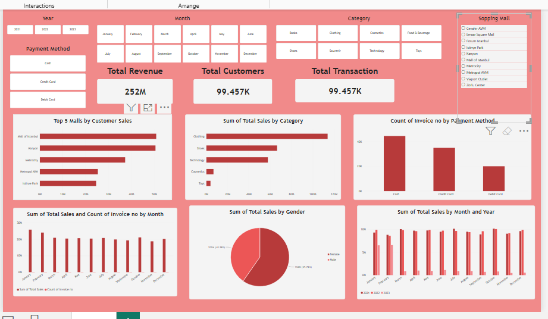

# Sales Analysis Dashboard

## Project Overview
This project presents an interactive Sales Analysis Dashboard designed to analyze sales performance, customer behavior, product categories, payment methods, and shopping mall performance.

The dashboard provides meaningful business insights through interactive filters, KPI cards, and visualizations, helping users understand sales trends and customer purchasing patterns.

## Dashboard Preview

# Sales Analysis Dashboard

## Project Overview
This project presents an interactive Sales Analysis Dashboard designed to analyze sales performance, customer behavior, product categories, payment methods, and shopping mall performance.

The dashboard provides meaningful business insights through interactive filters, KPI cards, and visualizations, helping users understand sales trends and customer purchasing patterns.

## Dashboard Preview

## Key Performance Indicators (KPIs)

The dashboard highlights three important business metrics:

- **Total Revenue:** 252M
- **Total Customers:** 99.457K
- **Total Transactions:** 99.457K

## Dashboard Preview

## Dashboard Features

### 1. Interactive Filters (Slicers)
Users can filter the dashboard using:

- Year
- Month
- Product Category
- Payment Method
- Shopping Mall

### 2. Sales Analysis & Visualizations

The dashboard includes the following charts:

| Visualization | Description |
|---|---|
| Top 5 Malls by Customer Sales | Identifies the top-performing shopping malls. |
| Sum of Total Sales by Category | Compares revenue generated by different product categories. |
| Count of Invoices by Payment Method | Analyzes customer payment preferences. |
| Total Sales and Invoice Count by Month | Displays monthly sales and transaction trends. |
| Total Sales by Gender | Compares sales contribution by male and female customers. |
| Total Sales by Month and Year | Compares monthly revenue across different years. |

## Business Insights

This dashboard helps answer important business questions:

- Which shopping malls generate the highest sales?
- Which product categories contribute the most revenue?
- Which payment method is most frequently used?
- How do sales change over different months?
- Which gender contributes more to total sales?
- How does sales performance compare across different years?

## Tools & Technologies

- Microsoft Excel / Power BI (depending on the final dashboard implementation)
- Data Cleaning
- Data Analysis
- Pivot Tables
- Interactive Slicers
- Data Visualization
- KPI Reporting

## Project Objective

The main objective of this project is to transform raw sales data into an interactive dashboard that provides clear insights into business performance and supports data-driven decision-making.

---

**Author:** Abdul Moiz

**Project Category:** Sales Data Analytics & Dashboarding
## Key Performance Indicators (KPIs)

The dashboard highlights three important business metrics:

- **Total Revenue:** 252M
- **Total Customers:** 99.457K
- **Total Transactions:** 99.457K

## Dashboard Features

### 1. Interactive Filters (Slicers)
Users can filter the dashboard using:

- Year
- Month
- Product Category
- Payment Method
- Shopping Mall

### 2. Sales Analysis & Visualizations

The dashboard includes the following charts:

| Visualization | Description |
|---|---|
| Top 5 Malls by Customer Sales | Identifies the top-performing shopping malls. |
| Sum of Total Sales by Category | Compares revenue generated by different product categories. |
| Count of Invoices by Payment Method | Analyzes customer payment preferences. |
| Total Sales and Invoice Count by Month | Displays monthly sales and transaction trends. |
| Total Sales by Gender | Compares sales contribution by male and female customers. |
| Total Sales by Month and Year | Compares monthly revenue across different years. |

## Business Insights

This dashboard helps answer important business questions:

- Which shopping malls generate the highest sales?
- Which product categories contribute the most revenue?
- Which payment method is most frequently used?
- How do sales change over different months?
- Which gender contributes more to total sales?
- How does sales performance compare across different years?

## Tools & Technologies

- Microsoft Excel / Power BI (depending on the final dashboard implementation)
- Data Cleaning
- Data Analysis
- Pivot Tables
- Interactive Slicers
- Data Visualization
- KPI Reporting

## Project Objective

The main objective of this project is to transform raw sales data into an interactive dashboard that provides clear insights into business performance and supports data-driven decision-making.

---

**Project Category:** Sales Data Analytics & Dashboarding
